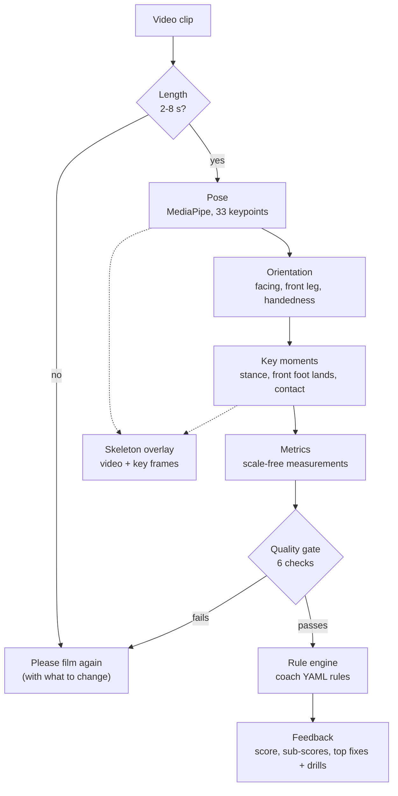

# Cricket Batting AI Coach

**Film one batting shot on your phone and get a score out of 100, a skeleton overlay of your technique, and the one or two things to fix first - with a drill for each.**

> **Status: working proof of concept.** The whole pipeline runs end to end on a normal laptop CPU (about 6 seconds for a 4-second clip). The scoring rules are **placeholders until coaches set them**, and nothing has yet been measured against real coach judgement. See [Known limitations](#known-limitations).

<!-- Replace the placeholders below with real captures (put the files in docs/). -->
| Result screen | Skeleton overlay with key moments |
|---|---|
|  *(screenshot placeholder)* |  *(demo GIF placeholder)* |

## What it does

1. A player films a **3-6 second, side-on clip** of one shot: **forward defence** or **front-foot drive**.
2. The system tracks 33 body keypoints, finds the three key moments of the shot, and measures technique (head position, front-knee bend, stride length, balance, front-elbow height, spine tilt).
3. It scores the shot against a **coach-editable rulebook** and returns:
   - a **score /100** with sub-scores for *Head & Balance*, *Footwork* and *Body Shape*,
   - the **top 1-2 fixes** in plain English, each with a drill,
   - a **skeleton-overlay video** with the key moments labelled, plus key-frame images,
   - a **confidence** for every number, derived from how clearly each joint was seen.
4. If the clip is not good enough (feet cut off, wrong camera angle, too short...) it does **not** guess. It returns a friendly "please film again" instruction instead, such as *"Move the camera back so your feet are visible for the whole shot."*

## How it works



The quality gate needs the pose, key moments and metrics to judge whether they can be trusted, so it runs after them and **before** anything is scored. The cheap clip-length check runs first so an over-long video is refused in a fraction of a second.

| Stage | Module | What it does |
|---|---|---|
| Pose | [`src/pose.py`](src/pose.py) | MediaPipe Pose Landmarker (Tasks API, video mode) gives 33 landmarks per frame with visibility. Raw data is kept; a One-Euro filter smooths a copy. |
| Orientation | [`src/orientation.py`](src/orientation.py) | Which way the batter faces, which leg is the front leg, left- or right-handed - a weighted vote of simple cues, each answer with a confidence. |
| Key moments | [`src/phases.py`](src/phases.py) | **Stance** (last still frame before the stride), **front-foot landing** (foot stops moving forward), **contact** (hands arrive at the front). Based on body-height-normalised velocities. |
| Metrics | [`src/metrics.py`](src/metrics.py) | Measurements at those moments, all divided by the batter's body size so camera distance does not matter. |
| Quality gate | [`src/quality.py`](src/quality.py) | Clip length, person found, whole body in frame, joints visible, camera side-on, key moments found. Shows only the root cause ("move the camera back"), not the knock-on effects. |
| Rule engine | [`src/scoring.py`](src/scoring.py) | Reads `rules/*.yaml`, scores each rule with a linear falloff, aggregates by weight, ranks fixes by *weight x deficit*. |
| Overlay | [`src/overlay.py`](src/overlay.py) | Skeleton video (browser-playable H.264) and key-frame PNGs. |
| Pipeline | [`src/pipeline.py`](src/pipeline.py) | `analyze(video, shot_type)` runs everything and returns one JSON-serialisable result. **No UI code**, so it can later sit behind a cloud API or run on-device. |
| UI | [`app.py`](app.py) | Gradio web app: analysis tab and coach-labelling tab. |

Design principles: every stage is a pure function over typed dataclasses; all coaching judgement lives in YAML, not code; all distances are normalised by body size; every output carries a confidence.

## Run it locally

Requires **Python 3.10+**. Nothing needs a GPU.

**Windows (PowerShell)**

```powershell
python -m venv .venv
.\.venv\Scripts\Activate.ps1
pip install -r requirements-dev.txt
python app.py
```

**macOS / Linux**

```bash
python3 -m venv .venv
source .venv/bin/activate
pip install -r requirements-dev.txt
python app.py
```

Then open <http://127.0.0.1:7860>. The 9 MB MediaPipe pose model is **downloaded automatically on first start** into `models/` (it is not stored in the repository); `python scripts/download_model.py` does the same by hand. `requirements-dev.txt` adds the test and plotting tools on top of `requirements.txt` (the runtime dependencies only, which is what the hosted Space installs). It includes `imageio-ffmpeg`, so you do not need to install ffmpeg yourself.

Useful commands:

```bash
python -m src.pipeline clip.mp4 forward_defence          # full analysis, prints JSON
python -m src.pose clip.mp4                              # detection rate and mean visibility
python scripts/plot_phases.py clip.mp4                   # debug plot of the velocity curves
python scripts/agreement_report.py                       # AI-vs-coach report (see below)
python scripts/prepare_example.py my.mov forward_defence # make an example clip for the app
pytest                                                   # the test suite
ruff check .                                             # lint
```

## Deploy it as a Hugging Face Space

The repository is ready to run as a free CPU Space (the YAML block at the top of this file is the Space configuration). The model downloads itself on startup, one analysis runs at a time on the free tier's 2 CPU cores, uploaded clips are deleted within about three hours, and the coach-labelling tab is hidden on a public Space (set `ENABLE_LABELLING=1` to show it). Step-by-step instructions: **[docs/deploy_hf_space.md](docs/deploy_hf_space.md)**. To show your own example clips on the Space, see [examples/README.md](examples/README.md).

## For coaches: editing the rules

All the coaching judgement is in two files, **no code changes needed**:

- [`rules/forward_defence.yaml`](rules/forward_defence.yaml)
- [`rules/front_foot_drive.yaml`](rules/front_foot_drive.yaml)

Each rule says what to measure, what "good" looks like, how forgiving to be, how much it matters, and what to tell the player:

```yaml
- id: stride_length
  label: Length of the front-foot stride
  category: "Footwork"                 # which sub-score it counts towards
  metric: stride_length                # what is measured ...
  moment: landing                      # ... and when (landing / contact)
  ideal: {min: 0.50, max: 0.90}        # full marks inside this range (body heights)
  tolerance: 0.30                      # score falls to 0 this far outside the range
  weight: 3                            # importance; also decides which fix is shown first
  fix:
    low:  "Your stride is short, so you are not getting your front foot close to the pitch of the ball..."
    high: "Your stride is too long. Over-reaching leaves you stretched, off balance..."
  drill:
    low:  "Place a marker on the floor about a bat-and-a-half in front of your front toe..."
    high: "Place a marker a little closer than your usual stride..."
```

- **`ideal`** may have only `min` or only `max`. **`fix`/`drill`** can be one text or `{low, high}` for "too little" versus "too much".
- The header of each file lists every available metric, its unit and sign convention (for example *head ahead of front knee, in torso lengths; negative = head behind the knee*).
- The files are **validated on load**: a typo, an unknown metric, a min larger than a max or missing `low`/`high` text is reported with the rule it belongs to, all at once.
- **Every number in the shipped files is a placeholder** (marked `PLACEHOLDER` in the file and shown in the app) until a coach sets it.

## How accuracy is measured

The built-in **Coach labelling** tab is how the AI is checked against people:

1. A coach loads a clip and sees what the AI decided.
2. They correct the three key frames with sliders, mark each technique check **Pass/Fail**, and give an overall score.
3. Labels are saved to `labels/labels.csv` (one row per item, next to the AI's value and a fingerprint of the rules version).

Then `python scripts/agreement_report.py` writes a markdown report with:

| Measure | What it tells you |
|---|---|
| **Per-rule accuracy and Cohen's kappa** | Does the AI pass/fail each check the way coaches do, beyond chance? Includes whether it is too harsh or too lenient. |
| **Key-moment timing error (ms)** | How far the AI's stance / landing / contact frames are from the coach's. |
| **Overall score correlation and mean error** | Does the AI rank clips like coaches do, and is its scale shifted? |

Small samples are flagged *(too few)*. **No coach labels have been collected yet, so there are no accuracy figures to quote.** The report exists so that tuning the rules is driven by evidence.

## Known limitations

This is a proof of concept; please read these before judging the output.

- **Scoring thresholds are placeholders.** They are sensible starting points based on standard coaching points, not validated by a coach. Scores are a guide, not a verdict.
- **No bat or ball tracking yet.** **Contact is approximate**: it is the frame where the hands have arrived and slowed after their forward drive, not the instant of impact. The simpler "peak hand speed" rule was tried and rejected because on the sample footage the hands peak *before* the foot lands.
- **Not yet validated against coaches** (see above), and so far tried on a **handful of clips of one batter**. Left-handers and left-facing clips are covered by synthetic tests only.
- **Two shots only:** forward defence and front-foot drive. Back-foot shots, sweeps, etc. are not supported.
- **Needs a clean clip:** one batter, static camera roughly square to the pitch, whole body in frame, 2-8 seconds, decent light. Anything else is rejected with advice (the thresholds are untuned beyond the sample clips).
- **2D measurements.** Angles and distances come from the image plane, which is right for a side-on camera but not for oblique views. The far-side limbs are often hidden, so the near-side joints are preferred and confidence is lowered when visibility is low.
- **Orthodox stance assumed** when inferring handedness (a right-hander leads with the left leg).
- **Webcam recording and the live Space are untested.** The free CPU tier has 2 cores, so expect a clip to take a few times longer than on a laptop, and the Space sleeps when idle.

## Phase 2: bowling

The design is deliberately shot-agnostic: **the engine does not change when the sport action does**. Adding bowling means adding three things, in the same shape as batting:

1. **A phase detector** in the style of [`src/phases.py`](src/phases.py): run-up, back-foot contact, front-foot contact, ball release, follow-through, found from keypoint velocities (for example the bowling wrist's peak speed for release).
2. **New metrics** in the style of [`src/metrics.py`](src/metrics.py): front-leg brace at front-foot contact, hip-shoulder separation, bowling-arm height at release, head position, run-up speed. They are normalised by body size like the batting ones.
3. **A rules file**, `rules/fast_bowling.yaml`, in exactly the same format coaches already edit.

Everything else is reused as it is: pose extraction, smoothing, orientation, the skeleton overlay, the rule engine with its validation, fix ranking and confidence, the quality gate's generic checks (length, person found, full body in frame, joint visibility), the pipeline's JSON result, the labelling tab and the agreement report.

*Honest scope note:* today the **three batting key moments are named in a few places** (`KeyMoments`, the metric table, the quality-gate advice, the labelling tab). Bowling means making the moment list configurable per shot type, a small, contained refactor rather than a rewrite.

## Project layout

```
app.py              Gradio web app (analysis + coach labelling tabs)
requirements.txt    runtime dependencies (what a Space installs); requirements-dev.txt adds test tools
packages.txt        system libraries a Space needs for OpenCV
examples/           your own example clips for the app (see examples/README.md)
labelling_tab.py    the coach-labelling tab
ui_cards.py         HTML cards shared by both tabs
src/                pose, orientation, phases, metrics, scoring, quality, overlay, pipeline, labels, agreement
rules/              coach-editable YAML rule files (one per shot)
scripts/            model download, debug plots, agreement report
labels/             coach labels (labels.csv)
tests/              synthetic poses with known answers: no video or model needed
data/               local sample clips (raw videos are git-ignored)
docs/               screenshots and demo GIF for this README
```

## Tech stack

Python 3.10+ - MediaPipe Pose Landmarker (Tasks API) - OpenCV and ffmpeg (via `imageio-ffmpeg`) for video - NumPy - PyYAML - Gradio 6 - pytest and ruff.
